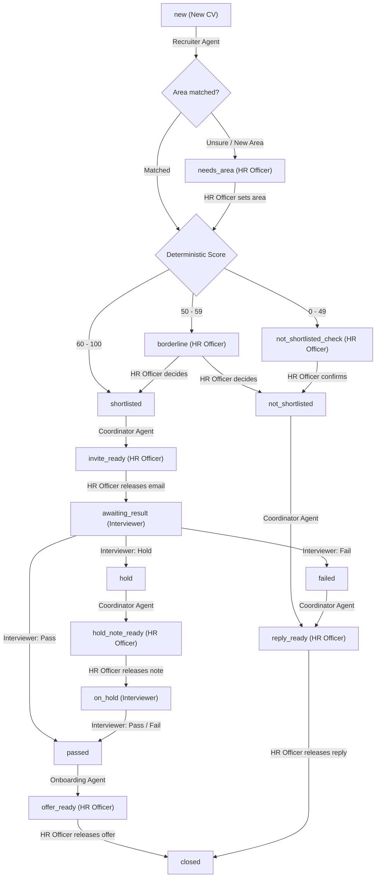

# Architecture Overview

## 1. System Design Principles

**HR Hiring** separates deterministic business rules from generative LLM tasks:
- **Deterministic Code (`hiring/tools.py`, `hiring/checks.py`, `hiring/db.py`):** CV text extraction, candidate scoring, interview slot allocation, work ID issuance, and factual verification are executed entirely in plain Python.
- **Checked LLM Steps (`hiring/employees.py`, `hiring/flows.py`):** The local LLM (`Gemma 3 4B` via `llama.cpp`) proposes structured JSON profiles, role area matches, interview questions, email drafts, and daily activity briefs. Every LLM output must pass verification checks against the source CV or candidate record before being persisted.
- **Human-in-the-Loop Gatekeeping (`hiring/actions.py`, `hiring/server.py`):** Borderline scores (50–59), low scores (<50), uncertain role areas, interview outcomes (`Pass`, `Fail`, `Hold`), and outbound email releases require explicit action from either the **HR Officer** or the **Interviewer**.

---

## 2. State Machine & Agent Hand-offs

The candidate's `status` column in `data/register.db` (`candidates` table) acts as the state machine trigger across the four agents and two human roles:

---

## 3. Component Breakdown

| Module | Purpose |
|---|---|
| `hiring/config.py` | Central configuration (scoring weights, thresholds, model endpoint, status definitions). |
| `hiring/db.py` | SQLAlchemy ORM models (`Candidate`, `Draft`, `Event`, `Run`, `Area`, `Brief`, `Setting`) and optimistic status locking (`expect_status`). |
| `hiring/llm.py` | HTTP client for `llama-server` (`/v1/chat/completions` and `/health`). |
| `hiring/checks.py` | Factual grounding validators ensuring extracted skills, evidence quotes, names, emails, and drafted numbers match the source CV and candidate record. |
| `hiring/tools.py` | PDF/DOCX/TXT extraction (`pypdf`, `python-docx`), weighted scoring engine (`40/30/20/10`), rule-based fallbacks, slot scheduler, and email templates. |
| `hiring/employees.py` | Loads agent prompts from `employees/<agent>/ROLE.md` and `routines/<routine>/SKILL.md`, executes up to `MAX_FIXES` retry loops on validation failure, and records lessons in `data/notes/`. |
| `hiring/flows.py` | LangGraph `StateGraph` definitions for `Recruiter`, `Coordinator`, `Onboarding`, and `Chief of staff`. |
| `hiring/scheduler.py` | Background `APScheduler` runner that triggers each agent according to its `SCHEDULE.md`. |
| `hiring/actions.py` | Role-checked mutations triggered by the HR Officer and Interviewer. |
| `hiring/server.py` | FastAPI web server with `TrustedHostMiddleware` and same-origin protection. |
| `web/` | Dependency-free vanilla JavaScript SPA (`app.js`, `index.html`, `style.css`). |
